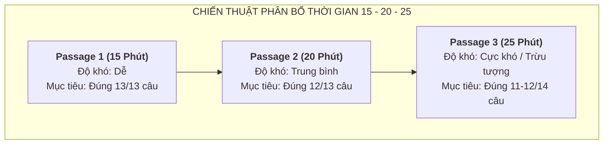

# IELTS READING BAND 8.0 - 9.0: BÁCH KHOA TOÀN THƯ TỪ CON SỐ 0
*Hệ thống giải đề độc quyền - Dành cho người ở bất kỳ trình độ nào (kể cả mất gốc/từ vựng yếu) vẫn đạt 35 - 38/40 câu*

---

# ⚠️ SỰ THẬT GIẢI OAN: TẠI SAO TỪ VỰNG KÉM VẪN ĐẠT ĐƯỢC BAND 8.0 READING?

Rất nhiều bạn nghĩ rằng muốn được 8.0 Reading thì phải biết hết 10,000 từ vựng tiếng Anh và đọc hiểu toàn bộ bài báo khoa học. **ĐÂY LÀ QUAN NIỆM HOÀN TOÀN SAI LẦM!**

> **BẢN CHẤT CỦA BÀI THI IELTS READING:**
> * Giám khảo cố tình đưa vào các thuật ngữ sinh học, khảo cổ, thiên văn cực khó (*e.g., bioluminescence, stratigraphy, echolocation*) để **hù dọa** thí sinh.
> * Bạn **KHÔNG CẦN BIẾT NGHĨA CỦA CÁC TỪ CHUYÊN NGÀNH NÀY**. Đáp án thực chất được quyết định bởi **Kỹ thuật đối chiếu từ đồng nghĩa (Paraphrase Matching)** và **Mối quan hệ logic trong câu**.
> * Chỉ cần bạn nắm vững **Bộ thuật toán định vị** và **Quy tắc toán học** trong tài liệu này, bạn chỉ cần hiểu khoảng 50 - 60% bài đọc nhưng vẫn chọn chính xác 36 – 38/40 câu!

---

# 📑 MỤC LỤC
- [CHƯƠNG 1: QUY TẮC PHÂN BỔ THỜI GIAN VÀ THỨ TỰ LÀM BÀI VÀNG](#chương-1-quy-tắc-phân-bổ-thời-gian-và-thứ-tự-làm-bài-vàng)
- [CHƯƠNG 2: THUẬT TOÁN ĐỊNH VỊ TỪ KHÓA CHO NGƯỜI MẤT GỐC (3-SECOND SCANNING)](#chương-2-thuật-toán-định-vị-từ-khóa-cho-người-mất-gốc-3-second-scanning)
- [CHƯƠNG 3: BỘ CÔNG THỨC DIỆT GỌN 7 DẠNG BÀI THI IELTS READING](#chương-3-bộ-công-thức-diệt-gọn-7-dạng-bài-thi-ielts-reading)
  - [Dạng 1: True / False / Not Given & Yes / No / Not Given (Toán học hóa 100%)](#dạng-1-true--false--not-given--yes--no--not-given-toán-học-hóa-100)
  - [Dạng 2: Summary / Note / Table Completion (Điền từ - Mỏ điểm tuyệt đối)](#dạng-2-summary--note--table-completion-điền-từ---mỏ-điểm-tuyệt-đối)
  - [Dạng 3: Matching Headings (Nối tiêu đề đoạn văn - Bắt từ chuyển hướng)](#dạng-3-matching-headings-nối-tiêu-đề-đoạn-văn---bắt-từ-chuyển-hướng)
  - [Dạng 4: Matching Information to Paragraphs (Nối thông tin vào đoạn A, B, C...)](#dạng-4-matching-information-to-paragraphs-nối-thông-tin-vào-đoạn-a-b-c)
  - [Dạng 5: Matching Features / Names (Nối tên nhà khoa học với phát biểu)](#dạng-5-matching-features--names-nối-tên-nhà-khoa-học-với-phát-biểu)
  - [Dạng 6: Multiple Choice (Trắc nghiệm 4 phương án - Kỹ thuật loại 3 bẫy)](#dạng-6-multiple-choice-trắc-nghiệm-4-phương-án---kỹ-thuật-loại-3-bẫy)
  - [Dạng 7: Sentence Completion & Short Answer Questions](#dạng-7-sentence-completion--short-answer-questions)
- [CHƯƠNG 4: BẢNG 150 CẶP TỪ PARAPHRASE KINH ĐIỂN XUẤT HIỆN TRONG 99% ĐỀ THI](#chương-4-bảng-150-cặp-từ-paraphrase-kinh-điển-xuất-hiện-trong-99-đề-thi)
- [CHƯƠNG 5: SỔ TAY "BẪY NOT GIVEN" - 5 DẤU HIỆU NHẬN DIỆN TRONG 5 GIÂY](#chương-5-sổ-tay-bẫy-not-given---5-dấu-hiệu-nhận-diện-trong-5-giây)
- [CHƯƠNG 6: QUY TRÌNH LUYỆN 20 BỘ ĐỀ CAMBRIDGE ĐẠT 36 - 40/40](#chương-6-quy-trình-luyện-20-bộ-đề-cambridge-đạt-36---4040)

---

# CHƯƠNG 1: QUY TẮC PHÂN BỔ THỜI GIAN VÀ THỨ TỰ LÀM BÀI VÀNG

Tổng thời gian làm bài là **60 phút cho 40 câu hỏi** (không có thêm thời gian chép đáp án).



### 🚨 THỨ TỰ LÀM CÂU HỎI BẮT BUỘC ĐỂ KHÔNG BỊ RỐI:
Trong mỗi Passage, các dạng câu hỏi được chia làm 2 nhóm:
1. **Nhóm In-Order (Câu hỏi đi theo thứ tự bài đọc):** *Gap-Fill, True/False/Not Given, Multiple Choice*.  
   ➔ **LUÔN LÀM NHÓM NÀY ĐẦU TIÊN!** (Vì tìm thấy câu 1 ở dòng 3 thì chắc chắn câu 2 sẽ nằm ở dòng 5–10, không bao giờ quay ngược lên dòng 1).
2. **Nhóm Non-Order (Câu hỏi nhảy lung tung):** *Matching Information, Matching Headings*.  
   ➔ **LUÔN ĐỂ LÀM CUỐI CÙNG CỦA PASSAGE!** (Sau khi bạn đã làm xong nhóm điền từ và T/F/NG, bạn đã hiểu rõ 70% nội dung bài rồi, lúc này quay lại nối thông tin chỉ mất 2 phút).

---

# CHƯƠNG 2: THUẬT TOÁN ĐỊNH VỊ TỪ KHÓA CHO NGƯỜI MẤT GỐC (3-SECOND SCANNING)

Để tìm được đáp án mà không cần dịch cả bài, bạn phải dùng mắt để tìm **MỎ NEO TỪ KHÓA (ANCHOR KEYWORDS)**:

| Loại Từ Khóa | Ví dụ cụ thể | Cách mắt quét trên trang giấy (Scan) |
| :--- | :--- | :--- |
| **Loại 1: Từ khóa Bất Biến (100% không thể bị đổi từ)** | • Chữ viết hoa: Tên người (*Dr. John*), Tên nước (*New Zealand*).<br/>• Con số / Năm / Tỷ lệ: *1998, 45%, 200 million*.<br/>• Thuật ngữ trong ngoặc kép hoặc in nghiêng: *"superbugs"*, *photosynthesis*. | Quét mắt theo hình chữ Z (từ trên xuống dưới, từ trái qua phải) để tìm đúng con số hoặc chữ in hoa đó trong **3 giây**. |
| **Loại 2: Từ khóa Biến Đổi (99% sẽ bị đổi từ đồng nghĩa)** | • Danh từ chung: *scientists, children, animals*.<br/>• Động từ: *produce, discover, damage*.<br/>• Tính từ: *important, dangerous, fast*. | Nhìn từ trong câu hỏi ➔ Nghĩ nhanh trong đầu từ đồng nghĩa của nó (ví dụ: *produce* ➔ *manufacture / yield / create*). |

---

# CHƯƠNG 3: BỘ CÔNG THỨC DIỆT GỌN 7 DẠNG BÀI THI IELTS READING

---

## DẠNG 1: TRUE / FALSE / NOT GIVEN & YES / NO / NOT GIVEN (TOÁN HỌC HÓA 100%)

> [!IMPORTANT]
> - **TRUE / FALSE / NOT GIVEN:** Dựa trên Sự thật thực tế (*Factual Information*).
> - **YES / NO / NOT GIVEN:** Dựa trên Quan điểm của tác giả (*Writer's Views / Claims*).
> *Cách làm của 2 dạng này giống hệt nhau 100%!*

```text
======================= MA TRẬN TOÁN HỌC CHO T/F/NG =======================

1. ĐÁP ÁN LÀ TRUE / YES:
   Khi MỌI THÀNH PHẦN trong câu hỏi (Chủ ngữ + Động từ + Tân ngữ) đều được tìm thấy 
   trong bài đọc dưới dạng TỪ ĐỒNG NGHĨA (Paraphrase).

2. ĐÁP ÁN LÀ FALSE / NO:
   Khi bài đọc CÓ THÔNG TIN ĐỐI LẬP TRỰC TIẾP (100% mâu thuẫn) với câu hỏi.
   (Bài đọc nói A, câu hỏi nói KHÔNG PHẢI A, hoặc khẳng định B trái ngược hoàn toàn).

3. ĐÁP ÁN LÀ NOT GIVEN:
   Khi bài đọc có nhắc đến đối tượng trong câu hỏi, NHƯNG KHÔNG CÓ THÔNG TIN để khẳng định 
   hoặc phủ định mối quan hệ/tính chất đó.
```

### 🎯 TUYỆT CHIÊU "BÀN TAY PHỦ ĐỊNH" (THE NEGATION METHOD)
*Khi bạn không biết câu đó là FALSE hay NOT GIVEN, làm theo 2 bước sau:*
* **Bước 1:** Thêm chữ `NOT` vào động từ chính của câu hỏi để phủ định nó.
* **Bước 2:** Đọc lại câu trong bài đọc:
  * Nếu câu phủ định đó **HOÀN TOÀN TRÙNG KHỚP VỚI BÀI ĐỌC** ➔ Chọn **FALSE**.
  * Nếu câu phủ định đó **VẪN KHÔNG TÌM THẤY TRONG BÀI ĐỌC** ➔ Chọn **NOT GIVEN**.

#### 🧪 Ví dụ minh họa thực tế:
* **Bài đọc:** *"Albert Einstein published his theory of relativity in 1915 while working in Germany."*
* **Câu hỏi 1:** *"Einstein's theory of relativity was made public in 1915."*  
  ➔ *made public* = *published*. Mọi chi tiết trùng khớp ➔ **TRUE**.
* **Câu hỏi 2:** *"Einstein published his theory of relativity while residing in Switzerland."*  
  ➔ Thử phủ định: "Einstein KHÔNG sống ở Thụy Sĩ khi công bố". Bài đọc nói rõ ông ở Đức (Germany) ➔ Mâu thuẫn trực tiếp ➔ **FALSE**.
* **Câu hỏi 3:** *"Einstein's wife helped him calculate the mathematical formulas for the theory of relativity."*  
  ➔ Thử phủ định: "Vợ Einstein KHÔNG giúp ông tính toán". Bài đọc có nhắc đến vợ không? Hoàn toàn KHÔNG NHẮC đến vợ ➔ **NOT GIVEN**.

---

## DẠNG 2: SUMMARY / NOTE / TABLE COMPLETION (ĐIỀN TỪ - MỎ ĐIỂM TUYỆT ĐỐI)

Dạng bài này **100% câu hỏi đi theo thứ tự bài đọc**. Bạn bắt buộc phải đạt điểm tối đa ở phần này.

### Quy trình 4 bước bất biến:
1. **Bước 1: Soi giới hạn từ:** Đọc kỹ dòng in hoa: *NO MORE THAN TWO WORDS AND/OR A NUMBER*.
2. **Bước 2: Dự đoán từ loại & Ngữ pháp (Grammatical Slotting):**
   * Đằng trước chỗ trống có `a / an` ➔ Chỗ trống bắt buộc là **Danh từ đếm được số ít** bắt đầu bằng phụ âm/nguyên âm.
   * Đằng trước có giới từ (*in, of, for, with*) ➔ Chỗ trống là **Danh từ hoặc V-ing**.
   * Đằng trước có to-be (*is, was, were*) ➔ Chỗ trống là **Tính từ hoặc V3/ed (bị động)**.
3. **Bước 3: Định vị từ khóa kẹp hai đầu:** Tìm từ khóa nằm ngay trước và ngay sau chỗ trống để quét đoạn văn.
4. **Bước 4: Bốc nguyên văn từ trong bài:** Không đổi số nhiều thành số ít, không tự ý biến đổi dạng từ.

---

## DẠNG 3: MATCHING HEADINGS (NỐI TIÊU ĐỀ ĐOẠN VĂN - BẮT TỪ CHUYỂN HƯỚNG)

> [!CAUTION]
> 80% thí sinh mất điểm vì đọc câu đầu tiên rồi chọn ngay tiêu đề. Ngày nay, câu đầu tiên của đoạn văn thường chỉ là **câu dẫn nhập (Background)**, ý chính thực sự nằm ở giữa đoạn!

### Thuật toán bắt "Từ báo hiệu chuyển hướng" (Signpost Words):
Khi đọc một đoạn văn, hãy lướt nhanh mắt tìm các từ sau:
* **Tín hiệu đảo ngược:** `However, But, Although, Yet, Nevertheless, In fact, Surprisingly...`  
  👉 **QUY TẮC VÀNG:** Ý chính của cả đoạn văn **90% NẰM NGAY SAU CÁC TỪ CHUYỂN HƯỚNG NÀY!**
* **Tín hiệu kết luận:** `Therefore, Consequently, As a result, Ultimately...`  
  👉 Ý chính là câu chứa các từ kết luận này.

---

## DẠNG 4: MATCHING INFORMATION TO PARAGRAPHS (NỐI THÔNG TIN VÀO ĐOẠN A, B, C...)

* **Đặc điểm:** Dạng câu hỏi này **KHÔNG THEO THỨ TỰ**, thông tin nằm rải rác khắp bài.
* **Chiến thuật đạt điểm 8.0:**
  * **Luôn để làm CUỐI CÙNG** của Passage đó.
  * Đọc câu hỏi, gạch chân **CỤM DANH TỪ TRỌNG TÂM** (ví dụ: *a reference to financial difficulties, an explanation of why animals migrate*).
  * Chú ý các từ tín hiệu trong câu hỏi:
    * *a description of...* ➔ Đoạn văn phải miêu tả chi tiết hình dáng/quy trình.
    * *a mention of / a reference to...* ➔ Đoạn văn chỉ cần nhắc phớt qua 1 câu là đủ.
    * *an explanation of...* ➔ Đoạn văn phải có giải thích nguyên nhân (*because, due to, since*).

---

## DẠNG 5: MATCHING FEATURES / NAMES (NỐI TÊN NHÀ KHOA HỌC)

1. Dùng bút khoanh tròn **TẤT CẢ TÊN CỦA CÁC NHÀ KHOA HỌC** xuất hiện trong bài đọc ngay từ phút đầu tiên.
2. Đọc câu chứa tên đó và câu liền sau nó. Chú ý các động từ thể hiện quan điểm:
   * *Dr. Brown argued that... / discovered that... / suggested that... / demonstrated that...*
3. So sánh ý kiến đó với danh sách các câu hỏi để chọn đáp án.

---

## DẠNG 6: MULTIPLE CHOICE (TRẮC NGHIỆM 4 PHƯƠNG ÁN - KỸ THUẬT LOẠI 3 BẪY)

Trong 4 phương án A, B, C, D, người ra đề luôn cài cắm 3 phương án bẫy theo công thức:

| Phương án | Đặc điểm nhận dạng | Cách loại bỏ |
| :--- | :--- | :--- |
| **Bẫy 1: Opposite (Ngược hoàn toàn)** | Chứa thông tin trái ngược với bài đọc. | Rất dễ nhận ra khi đọc kỹ vị ngữ. |
| **Bẫy 2: Not Mentioned (Không có trong bài)** | Ý kiến nghe rất đúng về mặt đời sống thực tế, nhưng bài đọc **hoàn toàn không đề cập**. | Loại bỏ vì không có thông tin chứng minh. |
| **Bẫy 3: Distractor (Con mồi giả - Nguy hiểm nhất)** | **Chứa y nguyên 100% từ vựng của bài đọc**, nhưng ngữ cảnh câu đã bị thay đổi hoặc chỉ là ví dụ phụ. | Thí sinh thấy từ giống bài đọc vội vàng chọn ngay ➔ Dính bẫy! |
| **ĐÁP ÁN ĐÚNG (The True Answer)** | **Không chứa từ vựng giống bài đọc**, mà được **PARAPHRASE LẠI BẰNG TỪ ĐỒNG NGHĨA HOÀN TOÀN!** | Đây là chìa khóa phân biệt giữa người được 6.0 và 8.5+. |

---

# CHƯƠNG 4: BẢNG 150 CẶP TỪ PARAPHRASE KINH ĐIỂN XUẤT HIỆN TRONG 99% ĐỀ THI

*(Học thuộc bảng này, tốc độ đọc và tỷ lệ chọn đúng của bạn sẽ tăng ngay 30%)*

### 1. Nhóm Động từ Hành động & Thay đổi:
* `improve / develop` = *enhance, upgrade, bolster, foster, ameliorate*
* `decrease / fall` = *plummet, slump, dwindle, contract, diminish*
* `stop / prevent` = *curb, impede, hinder, thwart, deter*
* `solve / deal with` = *tackle, address, resolve, alleviate*
* `damage / destroy` = *devastate, demolish, impair, blight*
* `produce / create` = *yield, generate, manufacture, fabricate*
* `discover / find` = *unearth, ascertain, identify, discern*
* `imitate / copy` = *emulate, replicate, simulate, mimic*
* `reveal / show` = *unveil, disclose, demonstrate, manifest*
* `ignore / overlook` = *disregard, neglect, turn a blind eye to*

### 2. Nhóm Tính từ Đánh giá & Tính chất:
* `important / main` = *paramount, vital, crucial, indispensable, pivotal*
* `dangerous / bad` = *perilous, hazardous, detrimental, adverse, pernicious*
* `difficult / hard` = *arduous, daunting, formidable, demanding*
* `huge / big` = *colossal, gargantuan, immense, massive, substantial*
* `small / unimportant` = *negligible, trivial, insignificant, marginal*
* `famous / well-known` = *renowned, celebrated, eminent, prominent*
* `complex / complicated` = *intricate, convoluted, sophisticated*
* `accurate / exact` = *precise, meticulous, flawless, rigorous*
* `surprising / strange` = *astonishing, bizarre, unprecedented, anomaly*
* `constant / continuous` = *relentless, perpetual, uninterrupted, sustained*

### 3. Nhóm Danh từ Trừu tượng:
* `benefit / advantage` = *dividend, boon, asset, virtue*
* `drawback / difficulty` = *pitfall, bottleneck, impediment, obstacle*
* `method / way` = *technique, approach, strategy, mechanism*
* `consequence / result` = *repercussion, ramification, outcome, aftermath*
* `characteristic / feature` = *attribute, trait, hallmark, facet*

---

# CHƯƠNG 5: SỔ TAY "BẪY NOT GIVEN" - 5 DẤU HIỆU NHẬN DIỆN TRONG 5 GIÂY

Khi gặp câu hỏi chứa 5 dấu hiệu sau mà bài đọc không nói rõ ràng, **90% đáp án là NOT GIVEN**:

1. **So sánh hơn (Comparatives):**  
   * Câu hỏi: *"A is more effective than B."*  
   * Bài đọc: Có nói về A tốt, có nói về B tốt, nhưng **KHÔNG HỀ SO SÁNH cái nào tốt hơn cái nào** ➔ **NOT GIVEN**.
2. **Nguyên nhân - Hệ quả (Cause and Effect):**  
   * Câu hỏi: *"A caused B to happen."*  
   * Bài đọc: Có xuất hiện hiện tượng A, có xuất hiện hiện tượng B trong bài, nhưng **KHÔNG CÓ TỪ NÀO NÓI A ĐẺ RA B** ➔ **NOT GIVEN**.
3. **Mục đích hoặc Ý định (Intentions / Plans):**  
   * Câu hỏi: *"Scientists aimed to commercialize this product."*  
   * Bài đọc: Các nhà khoa học tạo ra sản phẩm đó, nhưng **ý định kinh doanh** có hay không thì bài không viết ➔ **NOT GIVEN**.
4. **Cảm xúc hoặc Thái độ cá nhân (Emotions / Feelings):**  
   * Câu hỏi: *"The local residents were furious about the new highway."*  
   * Bài đọc: Có đường cao tốc mới, nhưng người dân **tức giận hay vui vẻ** thì bài không nhắc tới ➔ **NOT GIVEN**.
5. **Dự báo tương lai (Future predictions):**  
   * Câu hỏi khẳng định trong tương lai sẽ xảy ra X, nhưng bài đọc chỉ nói về hiện tại ➔ **NOT GIVEN**.

---

# CHƯƠNG 6: QUY TRÌNH LUYỆN 20 BỘ ĐỀ CAMBRIDGE ĐẠT 36 - 40/40

Để chắc chắn cầm tấm bằng **8.0 - 9.0 Reading**, hãy luyện theo đúng quy trình 4 bước của các thủ khoa:

```text
======================= QUY TRÌNH LUYỆN ĐỀ ĐỘT PHÁ =======================

Bước 1 (Làm đề bấm giờ thật - 60 phút):
• Không tra từ điển.
• Bấm giờ đúng 60 phút, chia mốc 15 - 20 - 25.
• Chấm điểm xem mình đúng được bao nhiêu câu.

Bước 2 (Giải phẫu bài đọc không giới hạn thời gian - BƯỚC QUAN TRỌNG NHẤT):
• Mở lại các câu làm sai.
• Dùng bút dạ quang tô đúng 1 câu trong bài đọc chứa đáp án.
• Tìm xem: "Từ nào trong câu hỏi tương đương với từ nào trong bài đọc?"

Bước 3 (Lập cuốn sổ "Paraphrase Diary"):
• Ghi lại cặp từ đồng nghĩa đã lừa bạn vào sổ:
  Ví dụ: Đề ghi "curb", bài đọc ghi "impede" ➔ Ghi lại vào sổ để nhớ.

Bước 4 (Đo lường tiến độ):
• Làm liên tục từ cuốn Cambridge 15 đến Cambridge 19 (tổng cộng 20 bài Test).
• Đến bài Test thứ 10, bạn sẽ nhận ra mọi bẫy của giám khảo đều lặp lại y hệt nhau.
• Khi bạn hoàn thành 20 đề, điểm của bạn sẽ ổn định ở mức 36 - 38/40 câu (Band 8.0 - 8.5+)!
```
