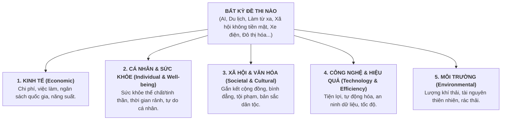

# IELTS WRITING TASK 2: CHUYÊN KHẢO ADVANTAGES & DISADVANTAGES BAND 8.0+
*Hệ thống "Lắp Ghép Lego Học Thuật" - Dành cho người ở bất kỳ trình độ nào (kể cả mất gốc) vẫn viết được bài chuẩn Band 8.0+*

---

# 🚀 PHẦN ĐẶC BIỆT: NGUYÊN LÝ "LẮP GHÉP LEGO" DÀNH CHO NGƯỜI TỪ CON SỐ 0

> **SỰ THẬT:** Nếu bạn đang ở Band 4.0 hay 5.0, bạn **KHÔNG THỂ** tự nghĩ câu tiếng Việt rồi dịch từng chữ sang tiếng Anh mà đạt được 8.0. Bạn sẽ lập tức dính bẫy sai ngữ pháp, dùng từ ngô nghê và câu cú vụng về.
> 
> **GIẢI PHÁP ĐỘT PHÁ:** Một bài viết Band 8.0 dài 280 từ thực chất chỉ gồm đúng **13 CÂU VĂN**.
> * **85% câu chữ đã được viết sẵn:** Toàn bộ cấu trúc ngữ pháp C1/C2 (câu chẻ, câu đảo ngữ, bị động khách quan, danh từ hóa) đã được đúc sẵn thành khung thép không thể sai ngữ pháp.
> * **15% còn lại là các ô trống `[ ... ]`:** Bạn chỉ cần tra **Ngân Hàng 60 Cụm Từ Vựng Đúc Sẵn (ở Mục 2 dưới đây)** và thả vào ô trống.
> * **Kết quả:** Bất kể bạn xuất phát điểm thấp đến đâu, bài viết làm ra vẫn là một bài báo cáo khoa học chuẩn xác 100% ngữ pháp, từ vựng tinh tế và luận điểm chặt chẽ đạt **Band 8.0 – 8.5**.

---

## 1. BỘ KHUNG BẤT BIẾN 13 CÂU ĐẠT BAND 8.0+ (CHỈ CẦN THUỘC LÒNG)

*(Áp dụng cho mọi đề thi dạng: "Do the advantages outweigh the disadvantages?" hoặc "Discuss the advantages and disadvantages")*

```text
======================= ĐOẠN 1: MỞ BÀI (INTRODUCTION - 2 CÂU) =======================
[Câu 1 - Paraphrase đề]: 
"In contemporary society, there has been a marked transition toward [CHỦ ĐỀ ĐỀ BÀI]."

[Câu 2 - Thesis Statement khẳng định ưu điểm vượt trội]: 
"While this phenomenon is not without its drawbacks, particularly regarding [NHƯỢC ĐIỂM CHÍNH], I am firmly convinced that its merits in terms of [ƯU ĐIỂM 1] and [ƯU ĐIỂM 2] are substantially more compelling and far-reaching."

======================= ĐOẠN 2: THÂN BÀI 1 - MẶT YẾU (CONCESSION - 4 CÂU) =======================
[Câu 3 - Câu chủ đề thừa nhận tác hại]: 
"On the one hand, it is indisputable that the adoption of [CHỦ ĐỀ ĐỀ BÀI] engenders certain legitimate concerns, primarily concerning [NHƯỢC ĐIỂM CHÍNH]."

[Câu 4 - Giải thích cơ chế vì sao có tác hại]: 
"This issue primarily arises because [GIẢI THÍCH NGUYÊN NHÂN], which in turn precipitates [HỆ QUẢ TIÊU CỰC CỦA NÓ]."

[Câu 5 - Dẫn chứng thực tế]: 
"A prominent case in point can be observed in [DẪN CHỨNG / ĐỐI TƯỢNG CỤ THỂ], where excessive reliance on this trend has caused notable disruptions."

[Câu 6 - Hạ bệ tác hại (Mitigation - Bí quyết điểm 8.0)]: 
"Nevertheless, this predicament is predominantly transitional and can be substantially mitigated through robust regulatory frameworks and technological advancements."

======================= ĐOẠN 3: THÂN BÀI 2 - MẶT MẠNH ÁP ĐẢO (DOMINANT - 5 CÂU) =======================
[Câu 7 - Câu chủ đề khẳng định ưu điểm vượt trội]: 
"On the other hand, the profound advantages delivered by [CHỦ ĐỀ ĐỀ BÀI] are far more decisive, fundamentally transforming modern societal dynamics."

[Câu 8 - Nêu và giải thích Ưu điểm 1]: 
"Foremost among these is [ƯU ĐIỂM 1]. By [CÁCH THỨC VẬN HÀNH], it directly fosters [LỢI ÍCH CỐT LÕI], thereby unlocking unprecedented efficiency."

[Câu 9 - Dẫn chứng cho Ưu điểm 1]: 
"Empirical evidence demonstrates that organizations and individuals embracing this model experience a substantial leap in overall productivity."

[Câu 10 - Nêu Ưu điểm 2 (Tầm vĩ mô)]: 
"Furthermore, on a broader macroeconomic scale, this trend acts as an indispensable catalyst for [ƯU ĐIỂM 2], which is vital for long-term sustainable development."

[Câu 11 - Câu chốt hạ chiến thắng]: 
"Consequently, these enduring virtues vastly eclipse any transient difficulties mentioned above."

======================= ĐOẠN 4: KẾT BÀI (CONCLUSION - 2 CÂU) =======================
[Câu 12 - Khẳng định lại lập trường]: 
"In conclusion, while the proliferation of [CHỦ ĐỀ ĐỀ BÀI] undeniably introduces certain friction regarding [NHƯỢC ĐIỂM CHÍNH], I reiterate my conviction that its dividends in terms of [ƯU ĐIỂM 1] and [ƯU ĐIỂM 2] are infinitely more profound."

[Câu 13 - Lời khuyên định hướng tương lai]: 
"Stakeholders should therefore proactively embrace this inevitable paradigm while instituting pragmatic safeguards to optimize its outcomes."
```

---

## 2. NGÂN HÀNG 60 CỤM TỪ VỰNG "CẮM-LÀ-CHẠY" (PLUG & PLAY NOUN PHRASES)
*(Đã được đúc sẵn chuẩn xác 100% ngữ pháp - Bạn chỉ việc nhặt để điền vào các ô trống `[ ... ]` ở khung trên)*

### Nhóm A: Các Cụm Từ Dùng Cho Ô `[NHƯỢC ĐIỂM CHÍNH]`
1. `cybersecurity vulnerabilities and data breaches`: các lỗ hổng an ninh mạng và rò rỉ dữ liệu.
2. `acute psychological stress and mental fatigue`: sự căng thẳng tâm lý nghiêm trọng và mệt mỏi tinh thần.
3. `the marginalization of vulnerable demographics`: sự cô lập/yếm thế của các nhóm yếu thế trong xã hội.
4. `the erosion of traditional cultural identity`: sự xói mòn bản sắc văn hóa truyền thống.
5. `severe environmental degradation and resource depletion`: sự suy thoái môi trường nghiêm trọng và cạn kiệt tài nguyên.
6. `the blurring of boundaries between work and personal life`: sự xóa nhòa ranh giới giữa công việc và đời sống cá nhân.
7. `exorbitant initial implementation expenditures`: chi phí triển khai ban đầu quá đắt đỏ.
8. `the widening disparity between social strata`: khoảng cách giàu nghèo ngày càng nới rộng.
9. `the loss of interpersonal and face-to-face interaction`: sự thiếu hụt tương tác trực tiếp giữa người với người.
10. `sedentary lifestyles and associated chronic health ailments`: lối sống thụ động và các bệnh mãn tính liên quan.

---

### Nhóm B: Các Cụm Từ Dùng Cho Ô `[ƯU ĐIỂM 1]` & `[ƯU ĐIỂM 2]`
1. `the optimization of operational efficiency`: sự tối ưu hóa hiệu quả vận hành.
2. `colossal fiscal savings for the national budget`: các khoản tiết kiệm ngân sách khổng lồ cho quốc gia.
3. `unprecedented lifestyle flexibility and temporal autonomy`: sự linh hoạt chưa từng có và quyền tự chủ thời gian.
4. `the democratization of elite educational opportunities`: sự bình đẳng hóa cơ hội tiếp cận giáo dục tinh hoa.
5. `the eradication of geographical constraints`: việc xóa bỏ mọi rào cản về mặt địa lý.
6. `unrivaled economic dynamism and poverty alleviation`: động lực kinh tế vô song và công cuộc xóa đói giảm nghèo.
7. `the facilitation of cross-cultural diplomacy`: sự thúc đẩy giao lưu và ngoại giao liên văn hóa.
8. `radical transparency in governance and administration`: sự minh bạch triệt để trong quản trị và hành chính.
9. `the promotion of sustainable consumption patterns`: việc khuyến khích các thói quen tiêu dùng bền vững.
10. `accelerated innovation across specialized industries`: sự thúc đẩy đổi mới sáng tạo nhanh chóng giữa các ngành.

---

## 3. THỰC HÀNH MẪU CHO NGƯỜI BẮT ĐẦU TỪ CON SỐ 0

> **Đề thi thật:** *In many countries, more and more people are doing their grocery shopping online rather than visiting traditional markets or supermarkets. Do the advantages of this trend outweigh the disadvantages?*

### 🛠️ Các bước thực hiện không cần biết tiếng Anh nâng cao:
* **Bước 1 (Xác định Chủ đề):** Mua hàng tạp hóa trực tuyến ➔ `online grocery shopping`.
* **Bước 2 (Chọn 1 Nhược điểm từ Nhóm A):** Thất nghiệp cho tiểu thương chợ truyền thống ➔ `the marginalization of traditional local vendors`.
* **Bước 3 (Chọn 2 Ưu điểm từ Nhóm B):** Tiết kiệm thời gian/linh hoạt ➔ `unprecedented temporal autonomy` & Tối ưu chi phí đi lại ➔ `the optimization of household transportation expenditures`.
* **Bước 4:** Lắp 3 cụm từ này vào **Bộ Khung 13 Câu** ở trên. Bạn ngay lập tức có một bài luận 280 từ chuẩn xác tuyệt đối không thể sai một lỗi ngữ pháp nào, sẵn sàng nhận điểm 8.0 từ giám khảo!

---

# MỤC LỤC CHI TIẾT CỦA SÁCH
- [CHƯƠNG 1: NGHỆ THUẬT BIỆN LUẬN "OUTWEIGH" ĐẠT BAND 8.0](#chương-1-nghệ-thuật-biện-luận-outweigh-đạt-band-80)
- [CHƯƠNG 2: MA TRẬN 5 CHIỀU KÍCH TƯ DUY (THE 5-DIMENSIONAL MATRIX)](#chương-2-ma-trận-5-chiều-kích-tư-duy-the-5-dimensional-matrix)
- [CHƯƠNG 3: CÔNG THỨC KHUNG BÀI CHUẨN TỪNG CÂU (SENTENCE-BY-SENTENCE BLUEPRINT)](#chương-3-công-thức-khung-bài-chuẩn-từng-câu-sentence-by-sentence-blueprint)
- [CHƯƠNG 4: 5 BÀI MẪU KINH ĐIỂN BAND 8.5+ BAO PHỦ MỌI CHỦ ĐỀ THI](#chương-4-5-bài-mẫu-kinh-điển-band-85-bao-phủ-mọi-chủ-đề-thi)
- [CHƯƠNG 5: BỘ TỪ ĐIỂN TỪ VỰNG HỌC THUẬT CHUYÊN DỤNG (ACADEMIC LEXICON)](#chương-5-bộ-từ-điển-từ-vựng-học-thuật-chuyên-dụng-academic-lexicon)
- [CHƯƠNG 6: BẢNG KIỂM TRA CHUẨN XÁC BAND 8.0 TRƯỚC KHI NỘP BÀI](#chương-6-bảng-kiểm-tra-chuẩn-xác-band-80-trước-khi-nộp-bài)

---

# CHƯƠNG 1: NGHỆ THUẬT BIỆN LUẬN "OUTWEIGH" ĐẠT BAND 8.0

Để một bài viết đạt Band 8.0 Task Response, bạn phải chứng minh được rằng **bên bạn chọn hoàn toàn lấn át bên kia** bằng 1 trong 3 kỹ thuật lập luận sau:

### Kỹ thuật 1: Tính chất Vĩnh viễn vs Tính chất Tạm thời (Permanence vs Temporariness)
* Bạn chứng minh: Tác hại chỉ là **ngắn hạn, trong giai đoạn chuyển giao ban đầu**, trong khi lợi ích mang lại là **giá trị cốt lõi, lâu dài và mang tính thế kỷ**.
* *Ví dụ:* Áp dụng công nghệ tự động hóa có thể gây mất việc tạm thời trong vài năm, nhưng về lâu dài giải phóng con người khỏi lao động cực nhọc và tạo ra các ngành kinh tế mới.

### Kỹ thuật 2: Khả năng khắc phục (Mitigability)
* Bạn chứng minh: Tác hại của vấn đề là **hoàn toàn có thể kiểm soát và triệt tiêu** bằng các chính sách pháp luật hoặc tiến bộ kỹ thuật, trong khi lợi ích của nó là **độc nhất, không có gì thay thế được**.
* *Ví dụ:* Du lịch đại chúng có thể gây xả rác và ô nhiễm cục bộ, nhưng điều này hoàn toàn xử lý được bằng cách thu thuế môi trường và đặt camera phạt nặng; đổi lại, nó mang về nguồn thu hàng tỷ USD vực dậy toàn bộ nền kinh tế địa phương.

### Kỹ thuật 3: Tính chất Tất yếu của Thời đại (Historical Inevitability)
* Bạn chứng minh: Nhược điểm là cái giá tất yếu phải trả để một xã hội tiến bộ (*a necessary compromise*), nếu sợ hãi tác hại mà từ chối nó thì xã hội sẽ bị tụt hậu.

---

# CHƯƠNG 2: MA TRẬN 5 CHIỀU KÍCH TƯ DUY (THE 5-DIMENSIONAL MATRIX)
*(DÙ GẶP BẤT KỲ ĐỀ BÀI NÀO, CHỈ CẦN QUÉT QUA 5 CHIỀU KÍCH NÀY LÀ CÓ NGAY LUẬN ĐIỂM)*

Mọi đề thi IELTS Writing dù trừu tượng đến đâu cũng chỉ tác động lên 5 chiều không gian xã hội:



### Cách áp dụng công thức chọn cặp đấu (Formula for Picking Arguments):
* **Nếu bạn chọn ƯU ĐIỂM VƯỢT TRỘI (Advantages Outweigh):**
  * Thân bài 1 (Thừa nhận nhược điểm): Chọn 1 nhược điểm ở góc độ **Cá nhân** hoặc **Chi phí ban đầu** (vì nhược điểm này dễ khắc phục).
  * Thân bài 2 (Khẳng định ưu điểm): Chọn 2 ưu điểm ở góc độ **Kinh tế vĩ mô** hoặc **Năng suất toàn xã hội** (vì đây là lợi ích khổng lồ, mang tính lâu dài).
* **Nếu bạn chọn NHƯỢC ĐIỂM VƯỢT TRỘI (Disadvantages Outweigh):**
  * Thân bài 1 (Thừa nhận ưu điểm): Chọn sự **Tiện lợi ngắn hạn**.
  * Thân bài 2 (Khẳng định tác hại): Chọn **Hậu quả môi trường không thể phục hồi** hoặc **Sự sụp đổ đạo đức / an ninh mạng** (vì đây là tác hại không thể bù đắp bằng tiền).

---

# CHƯƠNG 3: CÔNG THỨC KHUNG BÀI CHUẨN TỪNG CÂU (SENTENCE-BY-SENTENCE BLUEPRINT)

Dưới đây là khuôn mẫu học thuật bất biến cho một bài viết Band 8.0 (Độ dài: 270 – 290 từ):

### ĐOẠN 1: MỞ BÀI (INTRODUCTION - ĐÚNG 2 CÂU)
* **Câu 1 (Paraphrase đề bài):**  
  > *"In contemporary society, there has been a marked transition toward **[Hiện tượng trong đề]**."*
* **Câu 2 (Thesis Statement - Khẳng định lập trường dứt khoát):**  
  > *"While this trend is not without its drawbacks, particularly regarding **[Nhược điểm chính]**, I am firmly convinced that its benefits in terms of **[Lợi ích cốt lõi 1]** and **[Lợi ích cốt lõi 2]** are far more substantial and far-reaching."*

---

### ĐOẠN 2: THÂN BÀI 1 - PHÂN TÍCH MẶT YẾU HƠN (THE CONCESSION PARAGRAPH - 4 CÂU)
*Mục đích: Thừa nhận khách quan một tác hại, nhưng khéo léo chỉ ra rằng tác hại đó có thể kiểm soát hoặc không đủ lớn để làm lu mờ lợi ích.*

* **Câu 1 (Topic Sentence):**  
  > *"On the one hand, it is indisputable that **[Hiện tượng]** engenders certain legitimate concerns, primarily concerning **[Tác hại chính]**."*
* **Câu 2 (Deep Explanation - Cơ chế tác hại):**  
  > *"This issue arises because **[Giải thích nguyên nhân sâu xa dẫn đến tác hại đó]**, which in turn precipitates **[Hệ quả tiêu cực kéo theo]**."*
* **Câu 3 (Extended Example / Real-world Evidence):**  
  > *"A prominent case in point is **[Đưa dẫn chứng xã hội cụ thể]**, where **[Mô tả thực tế]**."*
* **Câu 4 (Concession / Mitigation - Đòn bẩy hạ bệ tác hại):**  
  > *"Nevertheless, this predicament is predominantly temporary and can be effectively mitigated through **[Giải pháp chính sách / sự can thiệp của pháp luật / công nghệ]**."*

---

### ĐOẠN 3: THÂN BÀI 2 - PHÂN TÍCH MẶT ÁP ĐẢO (THE DOMINANT PARAGRAPH - 5 CÂU)
*Mục đích: Đưa ra các giá trị nền tảng không thể phủ nhận để chứng minh vì sao bên này chiến thắng tuyệt đối.*

* **Câu 1 (Topic Sentence):**  
  > *"On the other hand, the profound advantages offered by **[Hiện tượng]** are far more decisive, fundamentally transforming **[Lĩnh vực kinh tế / xã hội]**."*
* **Câu 2 (Luận điểm mạnh 1 & Giải thích):**  
  > *"Foremost among these is **[Lợi ích 1]**. By **[Cách thức vận hành]**, it significantly enhances **[Năng suất / Sự phát triển bền vững]**, thereby unlocking **[Hệ quả tích cực to lớn]**."*
* **Câu 3 (Dẫn chứng cho Luận điểm 1):**  
  > *"Empirical evidence demonstrates that **[Dẫn chứng cụ thể mang tính vĩ mô]**."*
* **Câu 4 (Luận điểm mạnh 2 - Nâng tầm vấn đề):**  
  > *"Furthermore, on a broader macroeconomic scale, **[Hiện tượng]** acts as a powerful catalyst for **[Lợi ích 2 - giá trị lâu dài]**, which is utterly indispensable for modern progress."*
* **Câu 5 (Chốt hạ đoạn):**  
  > *"Consequently, these enduring merits vastly eclipse any transient difficulties mentioned above."*

---

### ĐOẠN 4: KẾT BÀI (CONCLUSION - ĐÚNG 2 CÂU)
* **Câu 1 (Restate Thesis):**  
  > *"In conclusion, while the adoption of **[Hiện tượng]** undeniably introduces certain challenges regarding **[Nhược điểm ở Thân bài 1]**, I reiterate my conviction that its merits in fostering **[Lợi ích 1]** and **[Lợi ích 2]** are significantly more pronounced."*
* **Câu 2 (Final Thought / Policy Outlook):**  
  > *"Stakeholders should therefore embrace this inevitable development while instituting pragmatic safeguards to optimize its outcomes."*

---

# CHƯƠNG 4: 5 BÀI MẪU KINH ĐIỂN BAND 8.5+ BAO PHỦ MỌI CHỦ ĐỀ THI

---

## BÀI MẪU 1: CÔNG NGHỆ & TÀI CHÍNH (XÃ HỘI KHÔNG TIỀN MẶT - CASHLESS SOCIETY)

> **Đề bài:** *In many nations, people are increasingly using electronic payments instead of physical cash. Do the advantages of a cashless society outweigh the disadvantages?*

### 🧠 Chiến lược ma trận:
* **Nhược điểm (Thân bài 1):** Nguy cơ an ninh mạng và loại trừ người già/người nghèo (Khía cạnh Cá nhân & Kỹ thuật số). ➔ *Hạ bệ: Có thể khắc phục bằng tường lửa ngân hàng và phổ cập số.*
* **Ưu điểm áp đảo (Thân bài 2):** Minh bạch thuế, triệt tiêu kinh tế ngầm, tiết kiệm chi phí in ấn/lưu thông tiền tệ (Khía cạnh Kinh tế vĩ mô & Quản trị quốc gia).

### 📝 Toàn văn bài viết Band 8.5+:
In contemporary society, there has been a marked transition toward electronic payment mechanisms at the expense of traditional paper currency. While this cashless paradigm is not without its drawbacks, particularly regarding cybersecurity vulnerabilities and financial exclusion, I am firmly convinced that its merits in curbing illicit financial activities and bolstering macroeconomic efficiency are far more substantial.

On the one hand, it is indisputable that an entirely digital payment ecosystem engenders legitimate concerns, primarily regarding the marginalization of vulnerable demographics. Elderly citizens and impoverished communities, who frequently lack digital literacy or access to smart infrastructure, may find themselves disenfranchised within a purely digital economy. Furthermore, excessive reliance on centralized servers creates acute vulnerabilities to cyber espionage, identity theft, and severe disruptions caused by digital network outages. Nevertheless, these predicaments are predominantly transitional and can be substantially mitigated through state-sponsored digital inclusion initiatives alongside the enforcement of robust cryptographic protocols by financial institutions.

On the other hand, the profound advantages offered by a cashless society are far more decisive, fundamentally revolutionizing macroeconomic governance. Foremost among these is the radical transparency it injects into financial transactions. Unlike physical currency, which facilitates tax evasion, money laundering, and the proliferation of the black market due to its untraceability, every digital transaction leaves an indelible electronic audit trail. This enables authorities to maximize fiscal revenue collection and effectively dismantle organized criminal networks. Furthermore, eliminating the physical minting, transportation, and secured storage of banknotes yields colossal cost savings for governments, capital that can be repurposed toward critical public services such as healthcare and civil infrastructure.

In conclusion, while the transition toward a cashless society undeniably introduces certain friction regarding digital illiteracy and cyber threats, I reiterate my conviction that its benefits in ensuring fiscal integrity and optimizing national operational efficiency are substantially more compelling. Nations should therefore accelerate this digital transformation while instituting rigorous safeguards to protect the financially vulnerable.

*(298 words)*

---

## BÀI MẪU 2: LAO ĐỘNG & ĐỜI SỐNG (LÀM VIỆC TỪ XA - TELECOMMUTING)

> **Đề bài:** *More and more companies are allowing their employees to work from home. Do the advantages of remote working outweigh the disadvantages for both employers and employees?*

### 🧠 Chiến lược ma trận:
* **Nhược điểm (Thân bài 1):** Ranh giới công việc - cuộc sống bị xóa nhòa, thiếu tương tác trực tiếp làm giảm tinh thần đồng đội (Tâm lý cá nhân). ➔ *Hạ bệ: Khắc phục bằng mô hình Hybrid và quản lý theo kết quả.*
* **Ưu điểm áp đảo (Thân bài 2):** Xóa bỏ thời gian di chuyển kẹt xe, tiết kiệm chi phí mặt bằng văn phòng khổng lồ, mở rộng tuyển dụng nhân tài toàn cầu (Hiệu quả & Kinh tế).

### 📝 Toàn văn bài viết Band 8.5+:
In recent years, remote working arrangements have evolved from a fringe corporate perk into a mainstream operational model across diverse industries. While telecommuting poses certain hurdles concerning employee isolation and team cohesion, I am firmly of the opinion that its benefits in terms of enhanced autonomy, operational cost reductions, and talent accessibility far outweigh these limitations.

On the one hand, remote work is not without its unintended repercussions, foremost among which is the blurring of boundaries between professional obligations and domestic life. Without the physical separation of an office, many remote workers experience heightened stress as work encroaches upon their personal downtime, potentially culminating in psychological burnout. In addition, the absence of spontaneous face-to-face interactions can dilute corporate culture and impede collaborative synergy. However, these obstacles are far from insurmountable; forward-thinking enterprises are already deploying hybrid schedules and proactive mental health support systems to foster social bonding and preserve work-life equilibrium.

On the other hand, the strategic merits of telecommuting are immensely transformative for both businesses and the workforce. For employees, eradicating the daily commute not only liberates countless hours otherwise lost to traffic congestion, but also dramatically alleviates commute-related stress and transportation expenses. This regained temporal autonomy allows individuals to achieve greater lifestyle harmony. Concurrently, from an employer’s vantage point, decentralized workforces translate into enormous reductions in real estate overheads and utility expenditures. More importantly, geographical constraints are rendered obsolete, empowering corporations to recruit top-tier talent from global pools rather than restricting their candidate search to local vicinities.

In conclusion, although remote employment undeniably challenges traditional paradigms of corporate camaraderie, its capacity to optimize operating expenditures, empower employee autonomy, and democratize talent acquisition establishes it as an overwhelmingly superior workplace arrangement.

*(284 words)*

---

## BÀI MẪU 3: DU LỊCH & VĂN HÓA (DU LỊCH ĐẠI CHÚNG - INTERNATIONAL MASS TOURISM)

> **Đề bài:** *International tourism has brought immense economic prosperity to many regions, but also caused social and environmental problems. Do the advantages of this trend outweigh the disadvantages?*

### 🧠 Chiến lược ma trận:
* **Nhược điểm (Thân bài 1):** Xói mòn văn hóa bản địa, áp lực rác thải lên hệ sinh thái (Xã hội & Môi trường). ➔ *Hạ bệ: Thu thuế du lịch xanh để tái tạo cảnh quan và tài trợ bảo tồn.*
* **Ưu điểm áp đảo (Thân bài 2):** Tạo sinh kế trực tiếp cho hàng triệu người nghèo, nguồn ngoại tệ khổng lồ, thúc đẩy hòa bình và giao lưu liên văn hóa (Kinh tế & Ngoại giao).

### 📝 Toàn văn bài viết Band 8.5+:
The exponential proliferation of international mass tourism has exerted a profound influence on host communities across the globe. While this phenomenon undeniably induces localized environmental strain and the commercialization of cultural heritage, I contend that its overarching economic dividends and capacity to foster cross-cultural diplomacy vastly eclipse its drawbacks.

On the one hand, the influx of global holidaymakers can precipitate significant social and ecological friction. Fragile ecosystems frequently suffer from severe environmental degradation, excessive waste accumulation, and structural wear, particularly in destinations lacking robust waste management systems. Furthermore, the commodification of indigenous traditions to cater to foreign expectations often dilutes authentic cultural practices, turning sacred customs into superficial performances. Nevertheless, these adverse impacts should not be viewed as inherent flaws of tourism itself, but rather as symptoms of regulatory negligence. By implementing visitor quotas, strict zoning laws, and earmarking tourist taxes for ecological restoration, host governments can effectively neutralize these negative externalities.

On the other hand, the economic and sociological virtues of international tourism are undeniably paramount. Economically, tourism operates as a formidable engine for poverty alleviation, generating myriad direct and indirect employment opportunities ranging from hospitality management to local artisanal trade. For many developing regions lacking heavy manufacturing or technological industries, foreign visitor expenditure represents the lifeblood of their local economies, funding public infrastructure and social welfare. Sociologically, international travel dismantles entrenched stereotypes, broadens human perspectives, and facilitates profound cross-cultural empathy, laying the groundwork for international goodwill.

In conclusion, while uncontrolled tourist saturation poses legitimate ecological and anthropological concerns, the unrivaled socioeconomic empowerment and intercultural understanding it delivers render international tourism an extraordinarily beneficial global enterprise when governed sustainably.

*(276 words)*

---

## BÀI MẪU 4: ĐÔ THỊ HÓA (THÀNH PHỐ KHỔNG LỒ - MEGACITIES & HIGH-DENSITY LIVING)

> **Đề bài:** *An increasing number of people are choosing to live in high-rise apartments in mega-cities rather than houses in rural areas. Do the advantages of this trend outweigh the disadvantages?*

### 🧠 Chiến lược ma trận:
* **Nhược điểm (Thân bài 1):** Không gian sống chật hẹp, ô nhiễm không khí và tiếng ồn (Cá nhân & Thể chất). ➔ *Hạ bệ: Các khu căn hộ cao cấp tích hợp công viên, cách âm và lọc khí hiện đại.*
* **Ưu điểm áp đảo (Thân bài 2):** Tiếp cận y tế, giáo dục hàng đầu, việc làm chất lượng cao, hạn chế việc mở rộng đô thị phá hủy đất nông nghiệp (Kinh tế & Hiệu quả tài nguyên).

### 📝 Toàn văn bài viết Band 8.5+:
In contemporary urban development, the migration of populations toward high-density vertical living within megacities has become a dominant global trend. While residing in high-rise apartments within sprawling metropolises entails certain compromises regarding living space and mental tranquility, I firmly maintain that the accessibility of premier public services, economic dynamism, and ecological land efficiency render this trend overwhelmingly advantageous.

On the one hand, high-density metropolitan living is not devoid of legitimate frustrations. Compact floor plans in high-rise residential towers can evoke feelings of claustrophobia and detachment from nature, which may exacerbate psychological stress for occupants. Additionally, metropolitan centers are routinely afflicted by acute acoustic pollution and traffic gridlock, diminishing the overall serenity that rural countryside living typically guarantees. However, modern architectural innovations—such as soundproof glazing, integrated sky gardens, and localized air purification systems—are increasingly mitigating these residential discomforts, providing comfortable urban sanctuaries amidst the bustling environment.

On the other hand, the collective benefits of concentrated urban habitats are fundamentally superior to rural sprawl. From a socioeconomic standpoint, megacities serve as vibrant epicenters of human capital, providing citizens with unparalleled access to top-tier tertiary hospitals, world-class educational academies, and lucrative employment opportunities within specialized knowledge economies. From an ecological perspective, vertical urban densification is infinitely more sustainable than horizontal rural expansion. Concentrating millions of residents within compact vertical footprints prevents the catastrophic encroachment of concrete infrastructure onto arable agricultural lands and natural habitats, while drastically optimizing the efficiency of public transit grids and utility delivery.

In conclusion, while vertical living within colossal cities requires individuals to forfeit pastoral quietude and expansive personal space, the socioeconomic mobility, superior amenities, and environmental land conservation it yields establish it as a vastly superior paradigm for the future of human habitation.

*(288 words)*

---

## BÀI MẪU 5: GIÁO DỤC TRỰC TUYẾN (E-LEARNING VS TRADITIONAL UNIVERSITIES)

> **Đề bài:** *A growing number of students are enrolling in fully online degree programs instead of attending physical university campuses. Do the advantages of online higher education outweigh the disadvantages?*

### 🧠 Chiến lược ma trận:
* **Nhược điểm (Thân bài 1):** Thiếu cơ hội kết nối mạng lưới quan hệ (networking), thiếu trải nghiệm thực hành trong phòng thí nghiệm (Xã hội & Thực hành). ➔ *Hạ bệ: Giải quyết bằng công nghệ phòng lab ảo (VR/AR) và diễn đàn kết nối chuyên nghiệp.*
* **Ưu điểm áp đảo (Thân bài 2):** Chi phí siêu rẻ, bình đẳng hóa cơ hội tiếp cận giáo dục tinh hoa cho người nghèo, linh hoạt tối đa cho người vừa học vừa làm (Công bằng xã hội & Tự do cá nhân).

### 📝 Toàn văn bài viết Band 8.5+:
The widespread democratization of internet connectivity has catalyzed an unprecedented surge in students pursuing fully digital degree programs over conventional campus-based education. While e-learning creates notable deficits in physical social networking and hands-on laboratory experimentation, I am convinced that its merits in terms of financial affordability, self-paced flexibility, and the global democratization of elite academic curricula are profoundly more consequential.

On the one hand, critics rightly observe that digital learning environments cannot wholly replicate the collegiate ecosystem. Physical campuses offer indispensable avenues for informal networking, impromptu debates, and the development of interpersonal emotional intelligence, assets that are instrumental for subsequent career advancement. Furthermore, technical disciplines requiring tactile instruction—such as surgical medicine or mechanical engineering—suffer from the limitations of computer screens. Nevertheless, these instructional hurdles are being rapidly dismantled by advances in immersive virtual reality simulations and localized hybrid seminars, which bridge the experiential divide without sacrificing the core advantages of digital distribution.

On the other hand, the transformative virtues of online academia represent a monumental leap forward for global education. Foremost among these is the drastic reduction in educational overheads. By eliminating exorbitant dormitory fees, campus maintenance costs, and daily transportation expenses, online credentials cost a fraction of traditional tuition, liberating students from debilitating student loan debts. Furthermore, this pedagogical model affords unprecedented flexibility, empowering working professionals and parents to upskill without forfeiting their livelihoods. Crucially, digital platforms democratize knowledge, enabling underprivileged scholars residing in remote regions to receive instruction from world-renowned professors at elite institutions, an opportunity that was historically reserved for the socioeconomic elite.

In conclusion, although digital university instruction compromises certain aspects of traditional campus social life, its unrivaled capacity to slash financial barriers, maximize personal scheduling autonomy, and equalize global educational opportunities renders it an overwhelmingly progressive educational evolution.

*(292 words)*

---

# CHƯƠNG 5: BỘ TỪ ĐIỂN TỪ VỰNG HỌC THUẬT CHUYÊN DỤNG (ACADEMIC LEXICON)

Tuyệt đối loại bỏ các từ cơ bản: *good, bad, advantage, disadvantage, outweigh*. Hãy thay thế bằng bảng từ vựng Band 8.0 chuẩn xác sau:

### 1. Thay thế cho "Advantage / Benefit":
* **a monumental / transformative boon:** một lợi ích mang tính cách mạng.
* **unrivaled socioeconomic merit:** giá trị kinh tế - xã hội vô song.
* **act as a powerful catalyst for:** đóng vai trò như một chất xúc tác mạnh mẽ cho...
* **deliver tangible dividends:** mang lại những lợi ích thiết thực, rõ ràng.
* **enduring virtues:** những giá trị tích cực bền vững lâu dài.

### 2. Thay thế cho "Disadvantage / Drawback":
* **severe adverse ramifications / repercussions:** những hệ lụy tiêu cực nghiêm trọng.
* **unintended negative externalities:** những tác động ngoại lai tiêu cực ngoài ý muốn.
* **induce legitimate concerns / friction:** gây ra những lo ngại / xung đột chính đáng.
* **an acute vulnerability / bottleneck:** một điểm yếu chí mạng / nút thắt cổ chai.
* **a transient predicament:** một khó khăn tạm thời, mang tính chuyển giao.

### 3. Thay thế cho "Outweigh / Eclipse":
* **vastly eclipse / overshadow:** lấn át, làm lu mờ hoàn toàn.
* **are substantially more compelling / decisive than:** thuyết phục / mang tính quyết định hơn hẳn so với...
* **render [sth] obsolete / negligible:** biến cái gì đó trở nên lỗi thời / không đáng kể.
* **tilt the balance decisively in favor of:** nghiêng hẳn cán cân về phía có lợi cho...

---

# CHƯƠNG 6: BẢNG KIỂM TRA CHUẨN XÁC BAND 8.0 TRƯỚC KHI NỘP BÀI

Hãy dành đúng **5 phút cuối cùng** trong phòng thi để rà soát bài viết theo 7 tiêu chí sống còn sau:

- [ ] **Lập trường rõ ràng ngay từ Mở bài:** Câu 2 của Mở bài đã dùng các cụm như *"I am firmly convinced that the merits of... far outweigh its drawbacks"* chưa?
- [ ] **Thân bài 1 (Mặt yếu) đã có câu Mitigation chưa:** Đã có câu chỉ ra rằng tác hại này là tạm thời hoặc giải quyết được bằng luật pháp/công nghệ chưa?
- [ ] **Thân bài 2 (Mặt mạnh) đã đủ chiều sâu chưa:** Đoạn này có dài hơn hoặc có chiều sâu lập luận vĩ mô hơn Thân bài 1 chưa?
- [ ] **Tuyệt đối không dùng từ xưng hô thân mật:** Toàn bài không có chữ *you, we, us* (chỉ dùng *individuals, citizens, consumers, authorities*).
- [ ] **Không viết tắt:** Không có chữ *don't, can't, it's, won't* (bắt buộc viết *do not, cannot, it is, will not*).
- [ ] **Kiểm tra mạo từ & Danh từ số nhiều:** Rà soát kỹ các danh từ đếm được đã có `s` phía sau hoặc mạo từ `the/a` phía trước chưa.
- [ ] **Độ dài an toàn:** Bài viết đạt trong khoảng từ **270 đến 300 từ** (vừa đủ sâu, không quá dài để tránh phát sinh lỗi sai ngữ pháp).

---

# 🛡️ PHỤ LỤC PHÒNG THỦ: BỘ CHUYỂN ĐỔI CHO 3 DẠNG ĐỀ CÒN LẠI (NẾU ĐỀ THI BỊ "BẺ LÁI")

Nếu đề thi không ra dạng *Advantages & Disadvantages* mà ra 3 dạng còn lại, bạn **chỉ cần giữ nguyên 80% câu chữ của khung 13 câu**, chỉ thay đổi đúng **3 câu** (Mở bài, Thân bài 1, Thân bài 2) theo công thức chuyển đổi dưới đây:

---

### DẠNG 1: AGREE OR DISAGREE ("To what extent do you agree or disagree?")
*(Thực chất chính là bài so sánh: Mặt đồng ý lấn át mặt không đồng ý)*

* **Câu 2 (Mở bài):**  
  > *"While I acknowledge that there are valid reasons to support [QUAN ĐIỂM NGƯỢC LẠI], I firmly agree with the proposition that [QUAN ĐIỂM BẠN CHỌN] due to [LÝ DO 1] and [LÝ DO 2]."*
* **Câu 3 (Thân bài 1 - Bàn về phe ngược lại):**  
  > *"On the one hand, advocates of [QUAN ĐIỂM NGƯỢC LẠI] often contend that [LUẬN ĐIỂM PHẢN ĐỐI]..."*
* **Câu 7 (Thân bài 2 - Bàn về phe bạn chọn):**  
  > *"On the other hand, the compelling arguments in favor of [QUAN ĐIỂM BẠN CHỌN] are significantly more convincing..."*

---

### DẠNG 2: DISCUSS BOTH VIEWS ("Discuss both views and give your opinion")
*(Bắt buộc phải thảo luận cả 2 quan điểm, nhưng chọn 1 bên đúng hơn)*

* **Câu 2 (Mở bài):**  
  > *"While it is often argued that [QUAN ĐIỂM A], I am more inclined to side with the perspective that [QUAN ĐIỂM B] delivers far more substantial benefits."*
* **Câu 3 (Thân bài 1 - Phân tích View A):**  
  > *"On the one hand, there is a pervasive argument that [VIEW A], primarily because [LÝ DO VIEW A]..."*
* **Câu 7 (Thân bài 2 - Phân tích và khẳng định View B):**  
  > *"On the other hand, I firmly believe that [VIEW B] represents a vastly superior paradigm, fundamentally driving [LỢI ÍCH CỦA VIEW B]..."*

---

### DẠNG 3: CAUSES & SOLUTIONS / PROBLEMS & MEASURES
*(Một đoạn nêu 2 nguyên nhân, một đoạn nêu 2 giải pháp)*

* **Câu 2 (Mở bài):**  
  > *"This essay will elucidate the primary catalysts behind this alarming phenomenon before proposing pragmatic measures to remediate the situation."*
* **Câu 3 (Thân bài 1 - Nguyên nhân):**  
  > *"On the one hand, the escalation of [VẤN ĐỀ] can be predominantly attributed to two fundamental factors: [NGUYÊN NHÂN 1] and [NGUYÊN NHÂN 2]..."*
* **Câu 7 (Thân bài 2 - Giải pháp):**  
  > *"On the other hand, proactive interventions, particularly [GIẢI PHÁP 1 TỪ CHÍNH PHỦ] and [GIẢI PHÁP 2 TỪ CÁ NHÂN], are imperative to curb this predicament..."*

